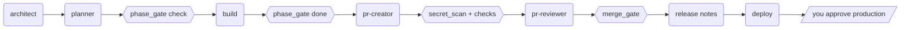

# build-crew

A small crew of Claude Code agents that plan, build, review, merge, release and deploy, so you approve work instead of babysitting it.

**Code for agents, docs for humans.**
Agents read the code. The few docs that exist are for people who want to understand and verify what happened. The checks that matter (did tests pass, did a review approve *this exact commit*, did the phase's Done-when commands pass) are decided by code gates that print JSON, not by an agent saying "looks good". See [Limits](#limits) for where the edges are.

---

## Install

**As a plugin (recommended)**, from inside Claude Code:
```
/plugin marketplace add ManeeshJupalle/claude-build-crew
/plugin install build-crew@build-crew
```
Plugin commands are namespaced, e.g. `/build-crew:ship`.

**Or manually**, globally for every project, with plain `/ship`-style names:
```bash
git clone https://github.com/ManeeshJupalle/claude-build-crew && ./claude-build-crew/install.sh
```
You need the [GitHub CLI](https://cli.github.com) (`gh auth login`), git, and Python 3.9+. Works on macOS, Linux and Windows (in Git Bash, which Claude Code on Windows already uses).

## Use

```
/kickoff "a URL shortener with analytics"   → docs/HOW_IT_WORKS.md + docs/PLAN.md
/build-phase 0                              → builds Phase 0, proven by its Done-when commands
/ship                                       → PR → review → merge (if every gate passes)
/build-phase 1 → /ship → …
/release → /deploy
```
Also: `/fix <bug>` · `/research <question>` · `/handoff` (the next session picks up where you left off).

## How it works


Rounded boxes are AI, hexagons are code, and the slanted box is you. Each step below has the same label and a way to verify it yourself. Gate paths are relative to the plugin folder. On Windows, type `python` instead of `python3`.

1. **Plan:** `AI`
   `architect` writes `docs/HOW_IT_WORKS.md` (≤ 150 lines: picture, steps, decisions, non-goals). `planner` writes `docs/PLAN.md`: small phases, each ending in runnable *Done when* commands.
   Verify: read both files. They're meant for you.
2. **May this phase start?** `Code`
   `phase_gate.py check` refuses if a dependency isn't done or the working tree is dirty.
   Verify: `python3 gates/phase_gate.py check 1`
3. **Build:** `AI`
   Claude builds the phase, following the existing code as the spec.
4. **Is it done?** `Code`
   `phase_gate.py done` runs the phase's Done-when commands and ticks the box only if they all pass.
   Verify: `python3 gates/phase_gate.py verify 1`
5. **Safe to commit?** `Code`
   `secret_scan.py` scans everything the branch changed since it left the base branch, committed or not, for keys, `.env` files and vendor folders (values are masked). `checks.py` runs the project's own lint, typecheck, tests and build. Missing tools show as SKIPPED, never PASS, and if nothing ran the gate fails as NOT VERIFIED, unless the change is docs-only.
   Verify: `python3 gates/checks.py --markdown`. The table is pasted into every PR.
6. **Review:** `AI`
   `pr-reviewer` has no file-writing tools. It judges what tools can't (logic, security, test quality, fit with your decisions) and posts a verdict pinned to the exact head commit.
   Verify: the review comment on the PR.
7. **Merge:** `Code`
   `merge_gate.py` merges only if the PR is open and mergeable, the latest verdict is APPROVE *for the current commit* and was posted from your own GitHub account (comments from anyone else are ignored), CI is green (or not configured; "not started yet" counts as pending), and the branch contains the latest base commit. The merge uses `--match-head-commit`, so a late push makes GitHub refuse it.
   Verify: `python3 gates/merge_gate.py <PR>` (check only).
8. **Release:** `Code` + `AI`
   `next_version.py` computes the SemVer from Conventional Commits. The AI writes release notes a person would want to read, and you approve them.
9. **Deploy:** `AI` + `Human`
   Staging plus smoke tests, then production **only after you say yes**, for the exact commit that passed staging. Failed production smoke tests trigger a rollback.

### Always on: `Code`
- **Guard hook** (`hooks/guard.py`) parses each shell command, including chained, grouped (`if`, `{ }`), nested (`bash -c`, `pwsh -c`, `cmd /c`) and `$(…)` commands, and blocks the destructive things agents actually do: force-push (any spelling), pushes or merges onto protected branches, skipping git hooks (`--no-verify`, `-n`, `HUSKY=0`, `core.hooksPath`), `reset --hard`, `git add -A`, recursive deletes of `/`, `~` or `.`, and merging PRs outside `merge_gate` (CLI, REST or GraphQL). Heredoc commit and PR messages are treated as text, not commands. It fails closed on anything it can't parse, and when Python is missing. 90+ test cases cover it.
- **Session hook** (`hooks/session_start.sh`) loads your last `/handoff` and phase progress into every new session.

## The crew

| Agent | Use it when | Judges (AI) | Can write |
|---|---|---|---|
| `architect` | starting a project or a big feature (`/kickoff`) | system shape, decisions, non-goals | `docs/HOW_IT_WORKS.md` |
| `planner` | right after the architect (`/kickoff`) | phase order and size | `docs/PLAN.md` |
| `researcher` | before picking a library, API or service (`/research`) | which option, with live sources | nothing |
| `debugger` | something is broken (`/fix`) | root cause and the smallest fix | code + regression test |
| `pr-creator` | work is finished locally (`/ship`) | commits and PR description | branch, PR |
| `pr-reviewer` | a PR needs review before merge (`/ship`) | correctness, security, tests, fit | one PR comment |
| `release-manager` | cutting a release (`/release`) | release notes | version files, CHANGELOG |
| `deployer` | shipping to staging, then production (`/deploy`) | deploy method, reading smoke results | nothing (runs the deploy) |

| Gate (code) | Decides |
|---|---|
| `phase_gate.py` | may a phase start, and is it done |
| `checks.py` | do lint, typecheck, test and build pass |
| `secret_scan.py` | is anything sensitive about to be committed |
| `merge_gate.py` | may this PR merge, and merges it |
| `next_version.py` | what the next version is |

See [examples/HOW_IT_WORKS.md](examples/HOW_IT_WORKS.md) and [examples/PLAN.md](examples/PLAN.md) for what the two planning docs look like.

## Limits

Gates make the important checks repeatable and visible. They are not a security boundary against a determined model, so you should know where the edges are:

- **The guard is a seatbelt, not a sandbox.** It stops the mistakes agents actually make. A command written specifically to evade it (an obfuscated script, or a file it writes and then runs) can get past. Use branch protection on GitHub for hard guarantees.
- **The reviewer and the builder share your GitHub account.** `merge_gate` ignores verdicts from other accounts, but it can't tell the reviewer agent from the main session. Branch protection with required human reviews closes that gap.
- **"Read-only" agents still have Bash** to run `gh` and `git`. They have no Write/Edit tools, and their instructions forbid changes, but that part is enforced by the prompt, not by code.
- **PLAN.md is editable.** A phase is "done" when its Done-when commands pass, but those commands live in a file the AI can edit. The reviewer flags changes to Done-when lines and phase ticks, and they show up in the PR diff.
- **Production approval** is enforced by the `/deploy` flow asking you. The deployer refuses without it, but that check is in the prompt.
- CI runs the tests on **macOS, Linux and Windows**.

## Contributing

Issues and PRs are welcome, especially new gates, agents, and stack support in `checks.py`. Start with [CONTRIBUTING.md](CONTRIBUTING.md). `pytest -q` runs 160+ tests in about 15 seconds, with no network.

## License

MIT © Maneesh Jupalle. See [LICENSE](LICENSE).
